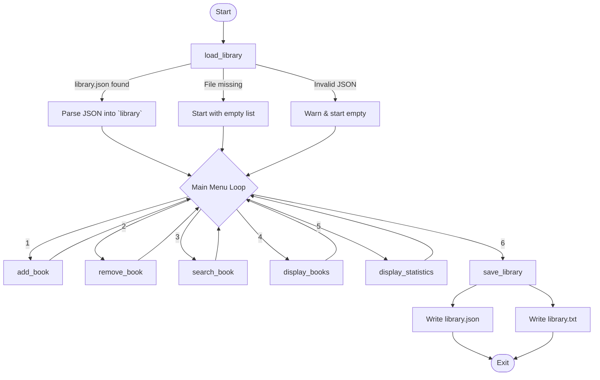
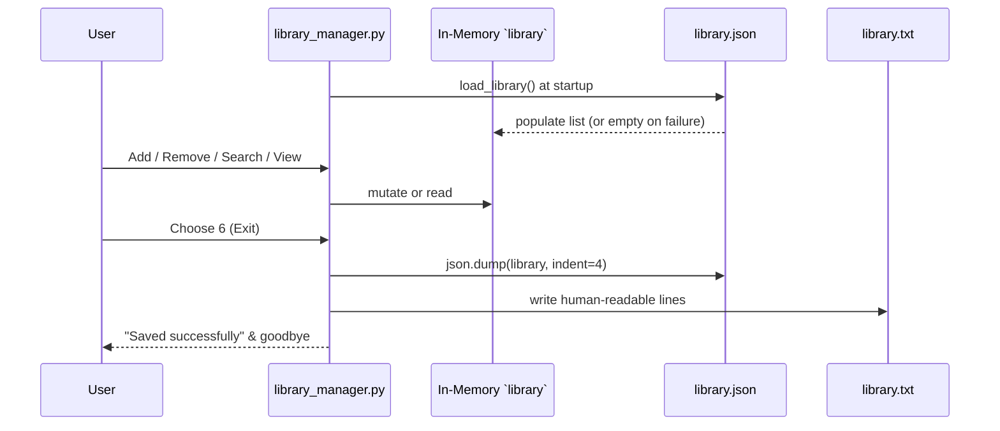

# 📚 Personal Library Manager

A clean, dependency-free **Command-Line Library Management System** written in pure Python. Add, remove, search, browse, and analyze your personal book collection — with automatic **persistent storage** in both machine-readable **JSON** and human-readable **plain text** formats.

<p align="center">
  
  
  
  
  
</p>

---

## 📑 Table of Contents

- [✨ Overview](#-overview)
- [🚀 Features](#-features)
- [🖥️ Demo / Preview](#️-demo--preview)
- [📦 Requirements](#-requirements)
- [⚙️ Installation](#️-installation)
- [▶️ Quick Start](#️-quick-start)
- [🧭 Usage Guide](#-usage-guide)
  - [1. Add a Book](#1-add-a-book)
  - [2. Remove a Book](#2-remove-a-book)
  - [3. Search for a Book](#3-search-for-a-book)
  - [4. Display All Books](#4-display-all-books)
  - [5. Display Statistics](#5-display-statistics)
  - [6. Exit & Save](#6-exit--save)
- [🗃️ Data Storage Format](#️-data-storage-format)
- [🏗️ Architecture & Data Flow](#️-architecture--data-flow)
- [🧩 Function Reference](#-function-reference)
- [🎯 Input Validation & Error Handling](#-input-validation--error-handling)
- [📁 Project Structure](#-project-structure)
- [🧠 Design Notes](#-design-notes)
- [🗺️ Roadmap / Known Limitations](#️-roadmap--known-limitations)
- [🤝 Contributing](#-contributing)
- [👨‍💻 Author](#-author)
- [📜 License](#-license)

---

## ✨ Overview

**Personal Library Manager** is a lightweight terminal application that turns a plain list of books into a persistent personal database. Every book is stored with its **title, author, publication year, genre, and read status**, and the entire library is saved automatically when you exit.

It was built as a beginner-friendly yet well-structured demonstration of:

- **File I/O & persistence** — reading/writing JSON and text files
- **CRUD operations** — create, read, update (via remove/re-add), delete
- **Defensive input validation** — safe handling of bad and missing data
- **Clean CLI design** — a numbered, user-friendly menu loop

No frameworks. No third-party packages. No setup headaches. Just Python.

---

## 🚀 Features

| Feature | Description |
|---|---|
| ➕ **Add Books** | Store title, author, publication year, genre, and read status |
| 🗑️ **Remove Books** | Delete any book by title (case-insensitive match) |
| 🔎 **Smart Search** | Partial keyword search by **title** *or* **author** |
| 📖 **Browse Library** | View the full collection in a numbered, readable list |
| 📊 **Statistics** | Total books, books read, and reading-completion percentage |
| 💾 **Dual Persistence** | Auto-saves to `library.json` (data) **and** `library.txt` (readable log) |
| 🛡️ **Safe Loading** | Gracefully recovers from missing or corrupted JSON files |
| ✅ **Validation** | Rejects empty fields and non-numeric publication years |
| 🌍 **Zero Dependencies** | Runs on the Python Standard Library only |
| 🌱 **Auto-Bootstrap** | Creates an empty library automatically on first run |

---

## 🖥️ Demo / Preview

```text
📚 Welcome to your Personal Library Manager!
1. Add a book
2. Remove a book
3. Search for a book
4. Display all books
5. Display statistics
6. Exit
Enter your choice: 1
Enter the book title: Atomic Habits
Enter the author: James Clear
Enter the publication year: 2018
Enter the genre: Self-Help
Have you read this book? (yes/no): yes
✅ 'Atomic Habits' added successfully!

Enter your choice: 4

📚 Your Library:
1. Atomic Habits by James Clear (2018) - Self-Help - ✅ Read

Enter your choice: 5

📊 Library Statistics:
📚 Total books: 1
✅ Books read: 1
📖 Percentage read: 100.00%

Enter your choice: 6
💾 Library saved to `library.json` & `library.txt` successfully!
📌 Exiting... Goodbye!
```

---

## 📦 Requirements

- **Python 3.8 or newer** (tested on Python 3.12)
- Any terminal / command prompt
- *No third-party packages required* — imports only `json`

---

## ⚙️ Installation

### 1. Clone the repository

```bash
git clone https://github.com/afaqulislam/personal_library_manager.git
cd personal_library_manager
```

### 2. (Recommended) Create a virtual environment

```bash
# Windows
python -m venv venv
venv\Scripts\activate

# macOS / Linux
python3 -m venv venv
source venv/bin/activate
```

### 3. Install dependencies

None needed — the project uses only the Python Standard Library.

---

## ▶️ Quick Start

```bash
python library_manager.py
```

On startup the app loads `library.json` (if it exists) and shows the main menu.

> 💡 **Tip:** Run the script from this folder so `library.json` and `library.txt` stay alongside the project.

---

## 🧭 Usage Guide

### 1. Add a Book

Select **`1`** and enter:

| Field | Required | Validation |
|---|---|---|
| Title | ✅ Yes | Cannot be empty |
| Author | ✅ Yes | Cannot be empty |
| Publication Year | ✅ Yes | Must be digits only (`isdigit()`) |
| Genre | ✅ Yes | Cannot be empty |
| Read status | ⚠️ Optional | `yes` → read, anything else → unread |

The book is appended to the in-memory library. **All required fields must be filled** or the entry is rejected.

### 2. Remove a Book

Select **`2`** and enter the title. Matching is **case-insensitive**, and the first match is removed. You'll get a success or "not found" message.

### 3. Search for a Book

Select **`3`**, then choose how to search:

- **`1` → By Title** — matches any book whose title *contains* your keyword
- **`2` → By Author** — matches any book whose author *contains* your keyword

Search is **substring-based** and case-insensitive, so `"habit"` finds `"Atomic Habits"`. Multiple matches are listed with numbering.

### 4. Display All Books

Select **`4`** to print every book in the library with its full metadata and a read/unread badge.

### 5. Display Statistics

Select **`5`** to see:

- 📚 Total number of books
- ✅ Number of books read
- 📖 Percentage read (formatted to 2 decimal places)

### 6. Exit & Save

Select **`6`** to write the library to disk and close the program. **Data is only persisted on exit**, so always leave via option `6` to avoid losing changes.

---

## 🗃️ Data Storage Format

### `library.json` — canonical data store

An array of book objects:

```json
[
    {
        "title": "Atomic Habits",
        "author": "James Clear",
        "year": 2018,
        "genre": "Self-Help",
        "read": true
    }
]
```

| Key | Type | Description |
|---|---|---|
| `title` | `string` | Book title |
| `author` | `string` | Author name |
| `year` | `integer` | Publication year |
| `genre` | `string` | Genre / category |
| `read` | `boolean` | `true` = read, `false` = unread |

### `library.txt` — human-readable mirror

Regenerated on every save, one line per book:

```text
Title: Atomic Habits | Author: James Clear | Year: 2018 | Genre: Self-Help | Read: Yes
```

---

## 🏗️ Architecture & Data Flow

The program follows a simple **load → mutate → save** lifecycle around a global in-memory list.





---

## 🧩 Function Reference

| Function | Purpose |
|---|---|
| `display_menu()` | Prints the numbered main menu |
| `add_book()` | Prompts for book details, validates them, appends to `library` |
| `remove_book()` | Finds a book by title (case-insensitive) and removes it |
| `search_book()` | Substring search by title or author |
| `display_books()` | Lists all books with formatted output |
| `display_statistics()` | Computes total, read count, and read percentage |
| `save_library()` | Writes `library.json` and `library.txt` |
| `load_library()` | Loads `library.json` with `FileNotFoundError` / `JSONDecodeError` handling |
| `main()` | Runs the `while True` menu loop and dispatches actions |

---

## 🎯 Input Validation & Error Handling

| Scenario | Behavior |
|---|---|
| Empty title / author / genre | `⚠️ All fields are required!` — entry rejected |
| Non-numeric year (e.g. `"abc"`) | `⚠️ Publication year must be a number!` — entry rejected |
| Read status not `"yes"` | Saved as **unread** (`false`) |
| Removing a non-existent book | `❌ Book '<title>' not found!` |
| Search returns nothing | `❌ No matching books found!` |
| Invalid menu choice | Prompt to enter a number between 1 and 6 |
| `library.json` missing | Starts silently with an empty library |
| Corrupted JSON | Warns and starts with an empty library |

---

## 📁 Project Structure

```text
personal_library_manager/
├── library_manager.py   # Main application (menu loop + all operations)
├── library.json         # Persistent data store (auto-created/updated)
├── library.txt          # Human-readable export (auto-generated)
├── README.md            # Project documentation
└── LICENSE              # MIT License
```

---

## 🧠 Design Notes

- **Single global state** — `library` is a module-level list shared by all functions; `load_library()` declares it `global`.
- **String normalization** — inputs are `.strip()`-ed and compared in lowercase, so searches and removals are forgiving.
- **Two output formats for two audiences** — JSON for reliable re-loading; TXT for quick inspection, sharing, or diffing.
- **Graceful degradation** — a broken or missing file never crashes the app; it falls back to an empty library.
- **Fail-safe menu loop** — the `while True` loop only exits on option `6`, keeping the session stable through bad input.

---

## 🗺️ Roadmap / Known Limitations

Current behavior worth knowing:

- 💾 **Saves only on exit** — editing the JSON while the app is running can cause overwrites. Use option `6` to save.
- 🔁 **No edit/update** — to change a book, remove and re-add it.
- 📅 **Year is digits-only** — negative or non-numeric years are rejected; no range validation (e.g. future years).
- 🔤 **Read status is binary** — only `yes` counts as read; there is no rating, notes, or progress.
- 🧮 **Search is simple substring** — no fuzzy matching, filters, or sorting options.
- 🖥️ **CLI only** — no GUI or web interface.

Ideas for future versions:

- [ ] Edit/update existing entries
- [ ] Sort by title, author, year, or genre
- [ ] Filter by read/unread status
- [ ] Autosave after every change
- [ ] Export to CSV
- [ ] Reading ratings, notes, and dates
- [ ] Optional SQLite backend
- [ ] Web UI (Streamlit / Flask)

---

## 🤝 Contributing

Contributions are welcome!

1. **Fork** the repository
2. **Create a branch** — `git checkout -b feature/library-improvement`
3. **Commit** your changes with clear messages
4. **Push** — `git push origin feature/library-improvement`
5. **Open a Pull Request** describing what you changed and why

Please keep the project **dependency-free** unless a new dependency is clearly justified.

---

## 👨‍💻 Author

**Afaq Ul Islam** — *Full Stack AI Web Developer*

- 🐙 GitHub: [@afaqulislam](https://github.com/afaqulislam)
- 💼 LinkedIn: [in/afaqulislam](https://www.linkedin.com/in/afaqulislam)
- 🌐 Portfolio: [afaqulislam.github.io](https://afaqulislam.github.io)
- ✉️ Email: [afaqulislam707@gmail.com](mailto:afaqulislam707@gmail.com)

Part of the **[25 Python Projects](https://github.com/afaqulislam/25-Python-Projects)** collection.

---

## 📜 License

Released under the **MIT License**. Free to use, modify, and distribute for personal and educational projects. See the [LICENSE](LICENSE) file for details.

<p align="center"><b>⭐ If you found this project useful, consider giving the repo a star!</b></p>
